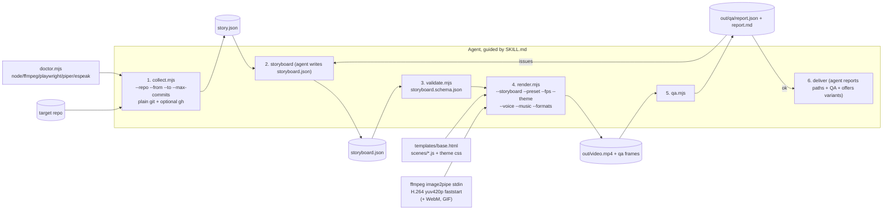
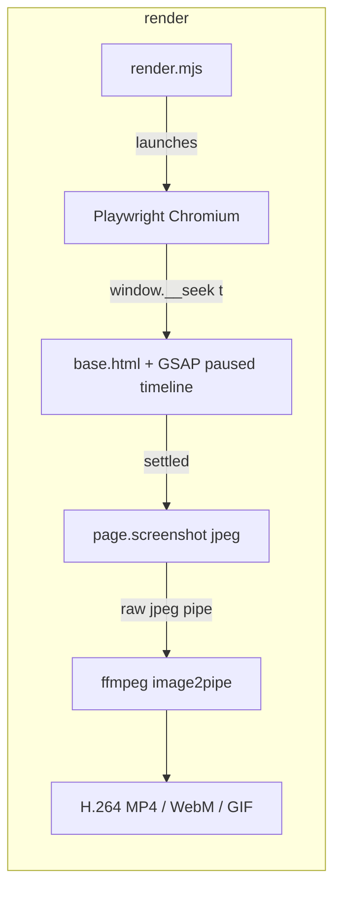

# PLAN.md — git2video

> Point your coding agent at any git repo and get a polished release video in one prompt.
> Status: Phase 0 (research + plan). One phase at a time; see checklist at the bottom.

## 1. Problem

Every release ships as a changelog nobody reads. Turning a release into a video today
means either (a) hand-editing in After Effects/CapCut (hours), (b) hosted SaaS
(release.show, DevReel — accounts, uploads, your code leaving your machine), or
(c) Remotion-based agent skills (require a Remotion project, React components, and a
license check in some org contexts). No existing open-source skill reads a repo's real
git history and produces an accurate, polished release video fully offline, for free,
with an automated quality loop.

## 2. Landscape research (verified Nov 2026)

Searches on GitHub + the web (Agent Skills ecosystem, "changelog video", "git history
video", "claude motion", skills.sh-style directories).

### Direct competitors (video from git/changelog)

| Project | What it does | Stack | Free/offline? | Gap we fill |
|---|---|---|---|---|
| **FavioVazquez/showtime** (~321★) | Local "video studio" skill for agents; has a `release-video` / `pr-video` route (from release notes, gh CLI) | local, engine unclear from docs | Yes (local) | Closest general tool. Not repo-first: reads **release notes/PR text**, not the git history itself; no git-only fallback documented; no deterministic storyboard schema; QA is advisory. No bundled storyboard→scene contract. |
| **oxygenframe/oxframe** (+ GitHub Action) | Release **notes** → template video; `oxframe check` layout check | Rust engine | Free core (repo); hosted option | Reads notes docs, not commits/diffs. Template-driven (TitleCard/BulletList/EndCard), no diff/stats/timeline scenes. |
| **heygen-com/hyperframes** (`changelog-video` skill) | Weekly changelog .md → branded changelog video | HyperFrames (AGPL-3.0) | Free; AGPL | Input is an authored changelog md, not git; AGPL (viral license); built around HyperFrames ecosystem, not standalone. |
| **social-media-skills/remotion-shorts-skill** | Changelog → vertical TikTok short | Remotion + React | Free; Remotion license | Requires Remotion project install; shorts-kinetic-text only, no diff scenes. |
| **mustafabakoglu/changelog-video** | npm CLI: git commits → release announcement **script** (text) | plain Node | Yes, trivial | Output is a script/markdown, not a video. |
| **shahanneda/videogit** | git commits → animated "typing code" video | Python + silicon + ffmpeg | Yes | 2020-era, single visual style (code typing), not a release story, not a skill. |
| **initialcommit-com/git-story** | git DAG → animated commit-graph video | Python + Manim | Yes | Animates the commit graph topology, not the release content; heavy Manim deps. |
| **EverMind-AI/Raven** | 2-min animated film from a repo's git history | inside Raven agent host | Free (hosted agent) | Locked to the Raven host, not portable SKILL.md. |
| **release.show / DevReel / agentreel** (SaaS) | GitHub releases → branded videos | cloud, closed | No (accounts, upload, paid tiers) | Not local, not private, not free. |

### General motion-design skills (adjacent, not git-aware)

| Project | What it does | License | Gap we fill |
|---|---|---|---|
| **remotion-dev/skills** (official) | Teaches agents to write Remotion components | Remotion engine license; skills MIT-labeled | No reproducible pipeline/scene templates; quality depends on the agent writing React correctly each time. |
| **Vincentwei1021/video-shotcraft** (~11k★) | Cinematic product promos from page screenshots + 157 shot recipe cards | Apache-2.0 | Product-promo focus; needs screenshots; heavy Remotion/Three.js; nothing about git. |
| **whaleyxbt/claude-motion** | Motion taste rules + frame contact-sheet self-review + sound engine | repo | Closest QA idea (contact sheet). Its self-review is agent-judgment on a sheet; ours is a scripted QA gate (ffprobe, variance, layout bounds, LUFS) + short agent loop. Not repo-history aware. |
| **cmak34/claude-remotion-skill**, Alon17-12/remotion-ad-video-skill, Liamrjohnston/remotion-motion-graphics-skill | Remotion templates/workflows for ads | mixed | All Remotion-bound; ad/product focus. |
| **calesthio/OpenMontage**, **heygen-com/hyperframes** (~60–79k★) | Full agentic video production systems | AGPL-3.0 / Apache-2.0 | Level of ambition much higher; heavy ecosystems; HyperFrames is AGPL. |
| **tuzhechen2005/opus-video-skills** (p5.js + headless chrome + ffmpeg) | Procedural video from prompts | MIT | Generic; no pipeline, no QA, no git. |

### Honest conclusion on the gap

- The *generic* "agent makes video" space is saturated. The *specific* product —
  "read a repo's real git history → accurate release video, zero cloud, zero licenses,
  scripted QA" — has no portable MIT agent-skill implementation. showtime and oxframe
  prove demand; both operate on written release notes rather than git itself, and
  neither ships a validated storyboard contract, secret scrubbing of diff hunks, or a
  scripted QA gate.
- We will NOT overclaim: showtime is a good local tool and is the closest rival; our
  comparisons above are fair and we will keep them honest in the README.

## 3. Differentiators (each must be real, verifiable in code)

1. **Real history, traceable claims.** `collect` uses plain `git` only (works without
   gh); every storyboard claim carries a `source` field with commit SHAs; validator
   rejects scenes whose `source` refs don't exist in story.json.
2. **Free, MIT engine.** No Remotion, no license keys, no CDN, no network at render
   time (Playwright blocks requests and fails loudly). GSAP from node_modules
   (verify MIT in Phase 1 — GSAP 3.13+ is MIT; commit a check).
3. **Scripted QA loop.** qa.mjs = ffprobe stream/duration/resolution checks, per-scene
   frame extraction + blank/variance detection, in-page layout audit (safe area +
   overflow), LUFS loudness bounds, report.json/report.md. Agent fixes visually from
   extracted frames, max 3 loops, then reports honestly.
4. **Privacy-safe offline.** Regex secret scrub on every diff hunk before it enters
   story.json (keys, tokens, PEM headers); contributor emails never enter any output;
   nothing leaves the machine.

## 4. Architecture





Render contract: page defines `window.__duration` and `window.__seek(t)` that sets the
paused GSAP timeline time and returns after layout settles; render.mjs steps
`t = n / fps`, screenshots, pipes frames to ffmpeg (no temp files). Determinism:
seeded PRNG only, no `Date.now()` in scenes, fixed viewport, no remote loads.

## 5. File tree (target)

```
git2video/
├── README.md  AGENTS.md  PLAN.md  ROADMAP.md  LICENSE  package.json
├── .github/workflows/ci.yml
├── launch/                    (Phase 8)
├── tests/                     node:test; fixture repo created programmatically
├── examples/                  dogfood output (Phase 7)
└── skills/git2video/
    ├── SKILL.md               (<150 lines, frontmatter: name+description only)
    ├── agents/openai.yaml     (Codex metadata)
    ├── scripts/
    │   ├── collect.mjs        git → story.json (secret scrub inline)
    │   ├── validate.mjs       storyboard → schema+reference checks
    │   ├── render.mjs         Playwright+ffmpeg engine
    │   ├── qa.mjs             QA gate
    │   └── doctor.mjs         env table + install hints
    ├── references/
    │   ├── storyboard-guide.md
    │   ├── storyboard.schema.json   (JSON Schema draft 2020-12)
    │   ├── design-tokens.md  motion-rules.md  faq.md
    └── templates/
        ├── base.html  render-contract.js
        ├── scenes/{title,highlights,diff,stats,timeline,breaking,contributors,outro}.js
        └── themes/{dark,light,neon}.css
```

## 6. Data contracts (outline)

**story.json** (collect output; documented in storyboard-guide.md, validated
structurally in validate.mjs):

```
repo{name}, range{from,to}, dateRange{start,end}, versionLabel,
commits{grouped: [type,count], total}, groupedByType{feat:[{sha,subject}...]},
breaking[{sha,subject,description}], stats{commits, files, additions, deletions,
contributors(topNamesOnly?*)}, topFiles[], diffs[{sha,file,hunk,sanitized}],
contributors[{name}]*   # * only with --include-contributors; never emails
```

**storyboard.schema.json** (JSON Schema draft 2020-12, used by validate.mjs):

```
{ meta:{repo,label,preset,theme,duration,fps},
  scenes:[{ id, type: enum[title,highlights,diff,stats,timeline,breaking,
                            contributors,outro],
            duration: number 1..15,
            narration: string (<=2 sentences),
            caption?: string,
            data: <type-specific, e.g. diff:{sha,file}, outro:{cmd,url}>,
            source: string  # must reference real shas present in story.json }]}
Rules (validated): scene order [title…outro]; total 15–75s; every type-specific
data ref resolves; narration present when voice != none; unique scene ids.
```

**out/qa/report.json**: `{ durations:{video,expected,ok}, streams:{video,audio},
resolution:{actual,expected,ok}, scenes:{id,frame ok,variance,overflows[]},
audio:{lufs,clipPeak,ok}, errors[], warnings[] }`

## 7. Per-phase task checklist

- **Phase 0 — this file + AGENTS.md + git init.** ✅ current
- **Phase 1 — scaffold + doctor + CI.** package.json (type:module, pinned deps:
  playwright, gsap, highlight.js), engines node>=22-ish (verify npx skills needs
  >=20), scripts/doctor.mjs (Node, ffmpeg, ffprobe, Playwright chromium; optional
  piper/espeak/vhs/docker; table + per-OS install hints), MIT LICENSE, .gitignore,
  CI skeleton (install deps + run doctor + npm test), AGENTS.md.
- **Phase 2 — collect.** collect.mjs (git log/diff --numstat/tag/fallback 30-day
  range; Conventional Commits parse + keyword heuristic fallback; breaking via
  `!`/footer; hunk selection ≤25 lines, skip lockfiles/binaries/generated +
  secret-scrub drop), README documents both install paths (npx skills add after
  verifying against vercel-labs/skills; manual .agents/skills + ~/.claude/skills),
  tests build a fixture git repo programmatically with known commits (incl. one
  fake "token" hunk asserting scrub), story.json golden test.
- **Phase 3 — render core + title scene.** base.html, render-contract.js
  (__seek/__duration), render.mjs (image2pipe→ffmpeg, --preset
  16:9/9:16/1:1, --fps 30/60, jpeg 90ish frames), network-blocking fail-loud,
  title scene + dark theme. Golden test: render a handwritten 2s storyboard →
  assert MP4 duration/resolution/frame count + frames non-blank. Commit
  a license-check script/test for gsap (must be MIT).
- **Phase 4 — scenes + themes + formats.** highlights, diff (highlight.js inlined,
  added/removed coloring + zoom), stats (counters, seeded easing), timeline,
  breaking, contributors (opt-in), outro; dark/light/neon themes via CSS vars;
  WebM + GIF (palettegen/paletteuse + auto shrink loop to <5MB target).
- **Phase 5 — voice/captions/music.** narration timing table: reading-time rule
  0.35s/word minimum; voice auto|piper|espeak|none with graceful fallback
  (+ measured clip length feeds scene durations); procedural music bed
  (ffmpeg lavfi / numpy), loudnorm ≈ −16 LUFS, low mix; burned captions when
  silent. CI: no-audio path; audio path only skipped-with-message.
- **Phase 6 — QA + SKILL.md.** qa.mjs full gate + report.json/report.md;
  scenes/*.js self-report text bounds to window.__layoutReport for the in-page
  audit; SKILL.md (≤150 lines, doctor→collect→storyboard→validate→render→qa→look
  at frames→fix≤3→deliver) with WHEN-triggering description; agents/openai.yaml;
  storyboard.schema.json + validate.mjs with precise errors; test: deliberately
  overflowing caption is caught.
- **Phase 7 — dogfood.** Follow SKILL.md literally on this repo's own history;
  save to examples/; fix SKILL.md where unclear; record confusion points.
- **Phase 8 — README/docs/launch/audit.** README per Section-4 template
  (honest comparison table), launch/, release-video GitHub Action example
  (+ `act` test if available else "documented as untested"), final audit items
  1–6, `npx skills add <owner>/<repo>` install path verified.

## 8. Risks & mitigations

| Risk | Mitigation |
|---|---|
| Playwright Chromium download (~120–170 MB), missing ffmpeg | doctor.mjs prints per-OS install hints (`npx playwright install chromium`, brew/apt/winget); CI installs with `--with-deps` |
| Windows: bash-only logic forbidden | All core scripts are .mjs; use `node:` child_process + path; doctor also ships .ps1/.sh variants if needed |
| GSAP licensing doubt | Pin gsap in keywords/license tests; GSAP 3.13 is MIT (`License: "MIT"` in package.json) — assert in test, fail build if changed |
| Determinism across machines (system fonts differ) | Same-machine byte-similar golden frames only; cross-platform documented; allow optional bundled OFL font via npm later |
| Diff hunks leak secrets | Regex scrub (aws keys, ghp_/sk-, bearer, PEM, generic key=value high-entropy) → drop whole hunk; unit-tested in Phase 2 |
| Text overflow/cut in scenes | In-page layout audit + safe-area rule + reading-time rule; QA fails the run, agent fixes ≤3 loops |
| GIF >5 MB | Auto-loop: reduce fps 15→10, width 50%→35% until under target, else warn and keep MP4 first-class |
| Long render times (30fps × 40s = 1200 screenshots) | jpeg screenshots + fast seek contract; keep default fps 30; document ~2–4 min renders |
| ffmpeg pipe frame dims mismatch | Fixed per-preset canvas size in CSS px == device pixels; assert first frame size |
| CI time | Playwright cache via actions/cache; golden render only 2s fixture |
| Name collision | `git2video` not found on GitHub/npm in research — keep, verify npm name with dry run when publishing |

## 9. Explicit non-goals (goes to ROADMAP.md later)

- Cloud/hosted rendering, team/brand templates, service-worker video preview UI,
  auto-posting to social, real-time preview server, more languages for voice.
